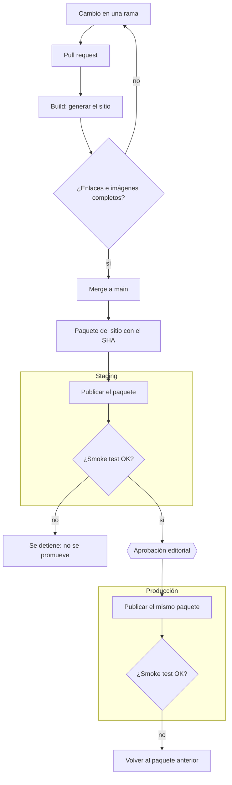

# Ejemplo resuelto: mapa de estrategia CI/CD - Sitio de la Revista Omega

> Este archivo muestra cómo se ve un mapa **terminado**. El caso es otro a propósito: un sitio web
> estático, no la API de tareas. El mapa de la API (`docs/mapa-cicd.md`) lo escribe cada persona,
> con la misma estructura y el mismo método. El método está al final.

## 0. El proceso manual de partida

La **Revista Omega** (empresa ficticia) publica su sitio así:

1. Quien publica genera el sitio en su computadora, con el generador de sitios estáticos, desde la
   carpeta que tenga en ese momento.
2. Abre el programa de FTP. El usuario y la contraseña del servidor están guardados en ese programa,
   en esa computadora.
3. Borra la carpeta `public_html` del servidor y sube la carpeta nueva. Mientras sube, el sitio no
   responde.
4. Abre la página principal en el navegador. Si se ve bien, listo.

**Si algo sale mal:** volver a subir la copia de la semana pasada, si alguien la guardó.

**Historial:** un artículo se publicó con enlaces rotos a otras notas; faltaron las imágenes de una
edición porque una carpeta no se subió; el sitio estuvo caído 20 minutos durante una subida lenta.

## 1. Flujo de commit a producción

**Cómo se lee:** todo cambio entra por un pull request. El pipeline genera el sitio en una máquina
limpia y revisa enlaces e imágenes; si algo falta, el cambio vuelve a la rama. Después del merge se
arma **un solo paquete**, identificado con el SHA del commit. Ese paquete se publica primero en
staging, sin intervención; si el smoke test pasa, una persona del equipo editorial aprueba y el
**mismo** paquete llega a producción. Hay un solo punto de decisión humana: la aprobación editorial.

## 2. Ambientes

| Ambiente | Para qué sirve | Cómo llega un cambio | Quién decide que llegue |
|---|---|---|---|
| Local | Escribir y previsualizar un artículo | Quien escribe genera el sitio en su computadora | Quien escribe |
| Staging | Ver el sitio que generó el pipeline antes de publicarlo | Automático, después del merge a `main` | Nadie: el pipeline |
| Producción | El sitio que leen los lectores | El mismo paquete que pasó por staging | Una persona del equipo editorial |

## 3. Riesgos del proceso manual y controles

| Paso | Riesgo | Qué puede pasar | Control del pipeline que lo atiende | Etapa del flujo |
|---|---|---|---|---|
| 1 | Se genera desde la carpeta que haya en esa computadora | Se publica un borrador, o se pierde un cambio de otra persona | El pipeline genera el sitio desde `main`, en una máquina limpia | Build |
| 2 | Credenciales guardadas en un programa de una sola computadora | Si esa computadora falla, nadie puede publicar; quien tenga acceso a ella sí puede | Credenciales guardadas como secreto del ambiente; solo el pipeline las usa | Despliegue |
| 3 | Borrar la carpeta y subir a mano | Sitio caído durante la subida; carpetas que no se suben (historial) | Se sube el paquete completo y se cambia de versión de una sola vez | Despliegue |
| 4 | "Si se ve bien, listo" | Enlaces rotos que nadie ve desde la portada (historial) | Verificador de enlaces en el pull request y smoke test después de publicar | Pruebas y validación posterior |
| Si algo sale mal | "La copia de la semana pasada, si alguien la guardó" | No hay a qué volver | Cada paquete queda guardado con su SHA; volver es publicar el paquete anterior | Artefacto |

## 4. Criterios de éxito

- La página principal y tres artículos elegidos responden con código 200, en staging y en producción.
- El verificador de enlaces reporta 0 enlaces rotos.
- El archivo `version.txt` publicado contiene el SHA del commit del paquete.
- Cada imagen que el sitio referencia responde con código 200.

Ninguno dice "se ve bien": cada uno se comprueba con un comando o con una respuesta del servidor.

## 5. Decisiones y preguntas abiertas

- La aprobación va después de staging y antes de producción: el equipo editorial revisa el sitio
  que generó el pipeline, no un archivo en la computadora de alguien.
- Pregunta abierta: ¿se publica a cualquier hora, o solo en el horario del equipo editorial?

Uso de IA: no se usó.

---

## Cómo se armó este mapa (el método)

1. **Leer el proceso manual y marcar** cada paso que depende de una persona, de su memoria, de su
   computadora o de la suerte. En este caso: los pasos 1 a 4 y el "si algo sale mal".
2. **Para cada marca, preguntar qué puede pasar.** El historial ayuda: cada incidente es un riesgo
   que ya ocurrió.
3. **Buscar el control del pipeline** que convierte ese paso en algo automático o verificable, y
   ubicarlo en una etapa del flujo (build, pruebas, artefacto, despliegue, validación posterior).
4. **Dibujar el flujo** con esas etapas, en orden, y marcar dónde decide una persona. La guía
   rápida de Mermaid tiene la sintaxis.
5. **Escribir los criterios de éxito** como cosas que una máquina comprueba: una respuesta, un código,
   un número.
