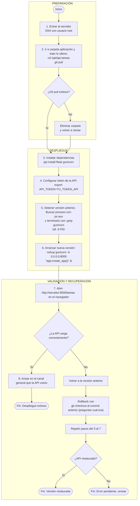

# Mapa de estrategia CI/CD - API de tareas

> Autor: Roberto Zambrana Serrano

> Punto de partida: `docs/DESPLIEGUE_MANUAL.md`, el proceso manual que el pipeline va a reemplazar.
> Cómo se ve un mapa terminado: `docs/ejemplo-mapa-cicd-sitio.md` (otro caso, mismo método).
> Sintaxis de los diagramas: la Guía rápida de Mermaid (Moodle, material de apoyo).

## 1. Flujo de commit a producción

## 2. Ambientes

| Ambiente | Para qué sirve | Cómo llega un cambio | Quién decide que llegue |
|---|---|---|---|
|PREPARACIÓN|Preparar ambiente de generacion de API |Quien entra al servidor trae la carpeta a su computadora |Quien entra al servidor |
|DESPLIEGUE|Detener version API anterior y arrancar nueva |mediante arranque de nueva version |El proceso o pipeline |
|VALIDACIÓN Y RECUPERACIÓN|Comprobar funcionamiento de la API |Por la misma nueva version iniciada en DESPLIEGUE |El proceso o pipeline |

## 3. Riesgos del proceso manual y controles

Un renglón por riesgo. La columna "Paso" cita el paso de `DESPLIEGUE_MANUAL.md`.

| Paso | Riesgo | Qué puede pasar | Control del pipeline que lo atiende | Etapa del flujo |
|---|---|---|---|---|
|1 |Se ingresa al servidor con usuario root |El usuario root es un usuario full access, por lo que se puede alterar informacion dentro del servidor |A nivel de pipeline el usuario tendria unicamente acceso a la carpeta requerida |PREPARACIÓN |
|2|Acceso directo a la carpeta de aplicacion |Alteracion de informacion o eliminacion de la carpeta |El pipeline indicaria que desde el main se crea un branch del repositorio de la carpeta y se trabajaria de manera local |PREPARACIÓN |
|3 |Ejecucion directa de pip install flask gunicorn |Conflictos con sistema operativo, en caso de escribirlo mal el nombre de una libreria se podrian descargar paquetes maliciosos y ademas, el mismo da errores a nivel de windows. Por ultimo, usar sudo no es la mejor practica porque otorga permisos elevados a los scripts. |Indicacion de crear un entorno virtual con python -m venv venv |DESPLIEGUE |
|4 |Exposicion de credencial en texto plano |Filtracion de una clave sensible de produccion |Cifrar la credencial o crear un archivo .env con permisos limidos de forma local, asegurarse de incluirlo en un archivo gitignore |DESPLIEGUE|
|5 |Detener version anterior |Interrupcion total o parcial de la API por mucho tiempo en caso de la nueva version no funcione y haya algun problema con el rollback |Mantener las la version anterior corriengo hasta asegurar que la nueva funciona |DESPLIEGUE |
|6 |Comando gunicorn -b 0.0.0.0:8000 |Es un comando muy permisivo y Gunicorn no configura TLS con este comando, por las comunicaciones serian HTTP sin cifrado |Utilizar 127.0.0.1:8000 y configurar TLS en el proxy inverso, ademas ejecutar el comando con un usuario dedicado y no como root |DESPLIEGUE |
|7 |Abrir `http://<servidor>:8000/tareas` en el navegador |Comunicaciones sin cifrar |Configurar TLS en el proxy inverso |VALIDACIÓN Y RECUPERACIÓN|
|8 |Avisar en el canal general que la API volvio |Proceso informal |Registro y resultados de despliegues en github|VALIDACIÓN Y RECUPERACIÓN|

## 4. Criterios de éxito

- La API carga correctamente.
- Se muestran comunicaciones HTTPS en el navegador.
- El proceso apruba un smoke test con 0 errores en el proceso.
- Se refleja un registro de estado de despliegue en algun repositorio seguro.

## 5. Decisiones y preguntas abiertas

- Se tomo la decision de expresar a modo de diagrama de flujo o pipeline el proceso actual, lo cual demuestra que el proceso no es para nada seguro en su modelo actual.
= Se tomo la decision de dividir el proceso en 3 etapas para que sea mas facil identificar riesgos en cada una.
- En la tabla de riuesgos y controles, se decidio escribir posibles controles oensando en un pipeline adecuadamente estructurado en cada etapa tecnica del proceso.
- Pregunta 1: Quien es el encargado de administrar las API?
- Pregunta 2: A quien se le avisa en caso de que la API funcione? es decir, quienes forman parte del canal general? 
- Pregunta 3: Quienes tienen acceso root al servidor SSH? 
- Pregunta 4: Que politicas existen en caso de aque la clave en texto plano se filtre? Que acciones se tomarian? 

Se hace uso de IA para perfeccionar el formato del diagrama.